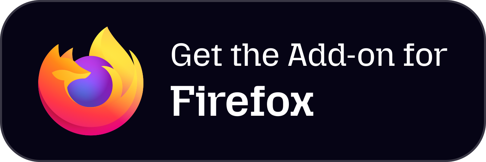

# Adaptive Tab Bar Colour Assets

Static brand assets and programmatic video workspace.

## Assets

|                                                  |                                                            |
| :----------------------------------------------: | :--------------------------------------------------------: |
|  |  |
| [atbc-rich-icon.svg](public/atbc-rich-icon.svg)  | [amo-download-button.svg](public/amo-download-button.svg)  |

## Video Workflow

1. Drop recordings or images into `public/`.
2. Preview in Remotion Studio:
    ```bash
    bun run dev
    ```
3. Render video:
    ```bash
    bunx remotion render Video out/video.mp4
    ```
